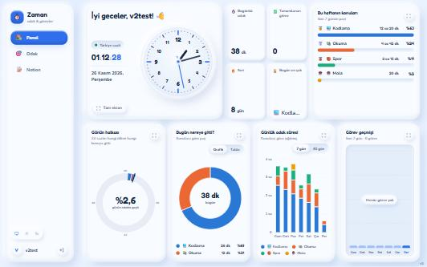
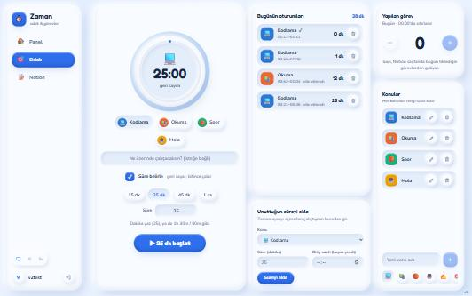
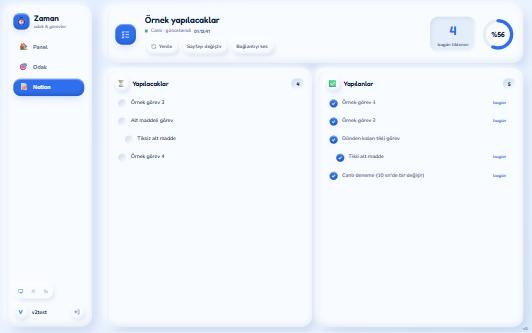
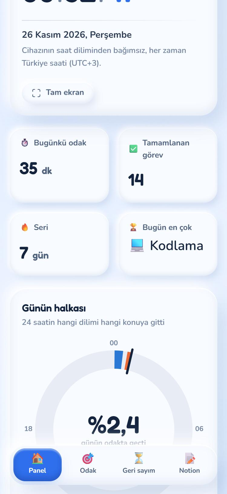

# Time & Task Tracker

A playful, clay-styled Turkish focus tracker built with Next.js 16 (App Router), TypeScript, Tailwind CSS, SQL Server, and Docker. Time your focus sessions per topic and see where the day went (share-of-time charts), count the tasks you finish, set a countdown on any focus session, and pull your to-dos from Notion (OAuth). Turkey time is a widget on the dashboard.

> Portfolio project. It needs a SQL Server instance, so there is no hosted demo; run it locally or with Docker (see below). The UI is in Turkish.

## Screenshots

| Dashboard | Focus |
| --- | --- |
|  |  |

| Notion | Mobile |
| --- | --- |
|  |  |

## Engineering Highlights

- **Time zone done properly** — every date is computed on the server in `Europe/Istanbul`, never from the device clock; the daily counter rolls over at Istanbul midnight even if no tab is open.
- **Optimistic, race-safe counter** — the UI updates instantly while requests are sequenced, the server writes with an atomic `MERGE ... OUTPUT`, and the client reconciles once the last in-flight write settles.
- **Notion OAuth without leaking tokens** — per-user tokens are encrypted with AES-256-GCM in the database, the flow is protected by a CSRF `state` cookie, and the browser never sees a token. The app only ever reads.
- **Near-live sync without webhooks** — adaptive polling (5 s, backing off to 20 s, paused while the tab is hidden) with a short server cache, single-flight requests and stale-data fallback. Notion webhooks are delayed and need a public URL, so polling fits better.
- **Defensive API layer** — `zod` validation, one `requireSession()` helper, parameterized SQL only, a rate-limited login, and a cached connection pool shared across requests.
- **Focus sessions with honest percentages** — one running session per user (a filtered unique index enforces it), sessions that cross Istanbul midnight are split between the two days, and shares are rounded with the largest-remainder method so they always add up to 100%.
- **Charts built for reading** — topic colours come from a fixed eight-slot categorical palette that was checked for colour-blind separation against both themes; a topic keeps its colour for life, every chart has a legend and a table view, and the 24-hour day ring is a custom SVG.
- **Accessible, motion-aware UI** — keyboard-navigable navigation with ARIA, live regions for status changes, and animations that follow `prefers-reduced-motion`.
- **Pure, easily testable core** — the tricky logic (duration parsing, to-do flattening with Istanbul day boundaries, token encryption) lives in small functions with no React or DOM dependencies. There is no automated test suite yet; `npm run lint` and `npm run build` are the checks.

## Features

- **Focus timer** — pick a topic (💻 Coding, 📚 Reading, …), press start, press stop. Tick **Süre belirle** to count down from a length you choose (20 min, `1h 30m`, …) instead of counting up. When the time is up the session is saved to the database at exactly that length (even if the browser is closed), a bell rings, and you are asked whether the task was completed, which also bumps today's task counter. Forgot to start the timer? Add minutes by hand. Topics can be renamed, re-emoji'd and archived (history keeps its colours).
- **Dashboard** — greeting, Turkey-time clock widget (digital + analog with a ticking second hand, fullscreen mode with a CSS fallback), stat tiles (focus today, tasks, streak, top topic), the 24-hour day ring, a "where did today go?" donut, weekly topic leaderboard, stacked 7/30-day bars and the task history. On a desktop screen the dashboard and the focus page fit without scrolling, and every chart has an expand button in its top-right corner that opens it full screen.
- **Daily Tasks** — optimistic atomic counter with Istanbul-midnight rollover and confetti on milestone hits (multiples of 5). When a Notion page is connected, the counter follows it (see Notion Integration).
- **Theme** — a sky-blue light theme and a navy dark theme (light/dark/system), saved per user in `Users.ThemePreference` and `localStorage`. No flash on load; the login page follows the theme.
- **Notion** — connect your own Notion account, pick a page and see its to-dos split into to do / done cards, with a completion ring and today's tick count. Today's ticks drive the daily counter, with near-live updates.
- **Clay UI** — puffy, toy-like surfaces (Fredoka + Nunito), a left sidebar on desktop and a bottom tab bar on phones (three sections: Panel, Odak, Notion), reduced-motion support and visible keyboard focus.
- **Auth & Security** — login only (no registration), httpOnly SameSite=Lax JWT cookie, bcrypt hashes, rate-limited login, parameterized queries, least-privilege DB user (`db_datareader`/`db_datawriter`).

## Tech Stack

- [Next.js 16](https://nextjs.org/) App Router, TypeScript
- [Tailwind CSS 4](https://tailwindcss.com/)
- [motion](https://motion.dev/) for animations
- [@number-flow/react](https://number-flow.barvian.me/) for animated digits
- [mssql](https://www.npmjs.com/package/mssql) for SQL Server
- [jose](https://github.com/panva/jose) + [bcryptjs](https://github.com/dcodeIO/bcrypt.js) for auth
- [canvas-confetti](https://www.npmjs.com/package/canvas-confetti)
- [date-fns-tz](https://www.npmjs.com/package/date-fns-tz)
- [Notion API](https://developers.notion.com/) (OAuth, read-only) for the Notion tab

## Requirements

- Node.js 20+ (or 24)
- SQL Server 2019+ (local instance or container)
- Docker (optional, for containerized run)

## Environment Variables

Copy `.env.example` to `.env` (runtime) and/or `.env.local` (local dev). All secrets must stay out of git.

| Variable | Required | Description |
| --- | --- | --- |
| `DB_SERVER` | yes | SQL Server host (e.g. `localhost` or `host.docker.internal`) |
| `DB_PORT` | yes | SQL Server port (e.g. `1433`) |
| `DB_NAME` | yes | Database name (e.g. `time_task_tracker`) |
| `DB_USER` | yes | App DB user (restricted to `db_datareader`/`db_datawriter`) |
| `DB_PASSWORD` | yes | App DB password (generated by `npm run db:setup` if missing) |
| `DB_TRUST_SERVER_CERTIFICATE` | no | `true` for local dev/self-signed certs |
| `JWT_SECRET` | yes | Secret used to sign httpOnly session cookies |
| `COOKIE_SECURE` | no | `true` to set `Secure` flag (set behind HTTPS) |
| `DB_ADMIN_USER` | setup only | SA/admin user used by `npm run db:setup` |
| `DB_ADMIN_PASSWORD` | setup only | SA/admin password used by `npm run db:setup` |
| `NOTION_CLIENT_ID` / `NOTION_CLIENT_SECRET` | for Notion | OAuth credentials of your Notion *public* integration |
| `NOTION_REDIRECT_URI` | for Notion | Must match the integration redirect URI (default `http://localhost:3000/api/notion/callback`) |
| `NOTION_TOKEN_KEY` | no | Key for encrypting stored Notion tokens (defaults to one derived from `JWT_SECRET`) |

See [`.env.example`](.env.example) for a filled template.

## Local Development

1. Install dependencies
   ```bash
   npm install
   ```
2. Configure `.env.local` with SQL Server and admin creds, and `.env` for app runtime.
3. Set up the database (idempotent). Creates DB/schema/tables/indexes, app login/user, grants least privilege, and writes `DB_PASSWORD`/`JWT_SECRET` to `.env.local` if missing.
   ```bash
   npm run db:setup
   ```
4. Create users (no public registration)
   ```bash
   npm run user:create -- <username> <password>
   npm run user:reset-password -- <username> <password>
   npm run user:list
   ```
5. Run the dev server
   ```bash
   npm run dev
   ```
   Open [http://localhost:3000](http://localhost:3000). If you switched from `next build` to `next dev`, the predev script clears a stale `.next` with `BUILD_ID` automatically.

## Docker (Production-like)

Multi-stage Dockerfile builds a standalone Next.js app as a non-root `nextjs` user. `docker-compose.yml` runs the app with `host.docker.internal` by default and an optional `db` profile for a local SQL Server container.

```bash
# Build and run
docker compose up -d --build

# Optional: run local SQL Server (host:14333)
# DB_SERVER=db DB_PORT=1433 DB_ADMIN_PASSWORD=... docker compose --profile db up -d
```

Health check: `GET /api/health`. Ensure SQL Server is reachable from the container and TCP/firewall is configured. The container reads `.env` (including the `NOTION_*` variables) through `env_file`, so rebuild/recreate it after changing `.env` (`docker compose up -d --build`).

## Notion Integration

Each signed-in user can connect their own Notion account in the **Notion** tab, pick one page, and see its to-dos (checkbox blocks) split into a "to do" list and a "done" list. The number of to-dos ticked **today** (Istanbul time, using the block last_edited_time) becomes today's count in the **Tasks** tab; while a page is selected the +/- buttons there are disabled. The integration is read-only.

Setup:

1. Create a **public** integration at <https://www.notion.so/profile/integrations> with the *Read content* capability and set its redirect URI (for example `http://localhost:3000/api/notion/callback`). Notion's form asks for a company name and privacy/terms URLs.
2. Put `NOTION_CLIENT_ID`, `NOTION_CLIENT_SECRET` and `NOTION_REDIRECT_URI` in `.env`.
3. Run `npm run db:setup` once (creates `dbo.NotionConnections`; the app DB user cannot create tables). Rebuild the Docker image after changing `.env`.
4. In the app: **Notion** tab, then connect, share the page(s) you want on Notion's consent screen, and choose the page in the picker.

Updates are near-live: while the Notion tab is visible it polls every 5 s (backing off to 20 s on errors, paused when the tab is hidden), and the Tasks tab refreshes every 8 s while the counter is locked. Notion webhooks are not used: they are batched with a delay of up to a few minutes and need a public HTTPS URL. If the selected page only contains sub-pages (no checkboxes of its own), the tab lists them so you can pick one.

Tokens are encrypted (AES-256-GCM) in the database and never sent to the browser. For local UI work without Notion, set `NOTION_MOCK` before `npm run dev`: `1` serves a fixture page, `container` starts on a page that only has sub-pages, `disconnected` shows the connect screen (all ignored in production).

## Time & Rollover Behavior

- Daily task key is `(UserId, CountDate)` with `CountDate` calculated in **Europe/Istanbul**.
- At 00:00 Istanbul the client detects the new day and reloads the count; the server computes the date per request so rollover works even if the tab was closed.
- A countdown focus session takes its length as `1h 30m`, `1h30m`, `90m`, or `90` (minutes, 1 minute to 24 hours) and stores it in `FocusSessions.PlannedMinutes`. The server closes the session at `StartedAt + PlannedMinutes` the next time sessions are read, so the saved time is exact even if no browser was open. The bell is app-wide; a page opened after the time ran out stays silent.
- All DB writes use parameterized queries. `COUNT >= 0` is enforced at the DB level.

## Scripts

| Script | Purpose |
| --- | --- |
| `npm run dev` | Next.js dev server (Turbopack) with predev cleanup guard |
| `npm run build` | Production build |
| `npm run start` | Start production server |
| `npm run lint` | ESLint |
| `npm run db:setup` | Idempotent DB/schema/user setup |
| `npm run user:create` | Create a user |
| `npm run user:reset-password` | Reset a user's password |
| `npm run user:list` | List users |

## Troubleshooting

| Issue | Fix |
| --- | --- |
| Theme stuck from another account | Theme is applied on login from `Users.ThemePreference`; reload if needed. |
| Page keeps reloading in dev | After `next build`, running `next dev` can mix artifacts. `npm run dev` now auto-clears `.next` if `BUILD_ID` exists. Hard-refresh (Ctrl+Shift+R) or reopen the tab. If it still loops (endless "Compiled" lines in the log), stop the dev server and delete the `.next` folder. |
| Notion tab says setup is incomplete | The `dbo.NotionConnections` table is missing: run `npm run db:setup`. |
| Notion connect fails or returns to the app with an error | `NOTION_REDIRECT_URI` must match the redirect URI saved in the Notion integration exactly (use `localhost`, not `127.0.0.1`), and the integration must be a *public* one. |
| Notion tab shows 0 items | The selected page has no checkbox blocks of its own (for example a year page that only contains sub-pages). Pick one of the listed sub-pages, or use "Change page". |
| A page is missing from the Notion page picker | Share it with the integration in Notion (page menu, Connections) and reopen the picker. |
| Wrong time shown | Timezone is fixed to `Europe/Istanbul`. If the device clock is wrong, the digital clock will reflect it. |
| Cannot connect to SQL from Docker | Use `host.docker.internal` with TCP enabled and firewall open, or use the `db` compose profile. |

## License

Released under the [MIT License](LICENSE).
